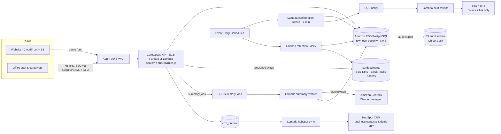

# CareQueue AWS architecture

## Components

| Concern | Service | Notes |
|---|---|---|
| Schedules, visits, queue, incidents, audit | **Amazon RDS for PostgreSQL** | `db/schema.sql`. Multi-AZ, KMS encryption, RLS by `agency_id`, append-only `audit_log` (trigger + grants). Optional `EXCLUDE` constraint to hard-block double bookings. |
| Documents (signed timesheets, incident attachments, audit exports) | **Amazon S3** | Private buckets, SSE-KMS with per-environment CMK, Block Public Access, TLS-only bucket policy, presigned URLs ≤ 5 min, Object Lock (compliance) for audit exports, lifecycle rules matching retention. |
| Administrative summaries & report wording | **Amazon Bedrock** | `infra/lambda/summary-worker.mjs` → `server/summaries.js`. Model `anthropic.claude-opus-5-5` via the Bedrock Mantle client, in the agency's region. IAM scoped to that one model. Drafts are always `pending_review`. |
| Notifications & background processing | **AWS Lambda** | `confirmation-sweep` (rules engine every minute), `notifications` (SES/SNS, counts only), `summary-worker`, `retention` (daily), `hubspot-sync`. Each has its own least-privilege role. |
| Identity | Amazon Cognito (SAML/OIDC federation) | MFA required for office roles; caregivers sign in on mobile. Demo build uses persona picker instead. |
| Edge | CloudFront, ALB, AWS WAF | Rate limiting on the public form; managed rule sets. |
| Secrets | AWS Secrets Manager | DB credentials, HubSpot private-app token. |
| Observability | CloudWatch Logs (no PHI in logs), CloudTrail, GuardDuty | Lambdas log IDs and error names only. |

## Why rules + LLM, not LLM everywhere

Conflict detection and confirmation monitoring are deterministic (`shared/rules.js`) so every queue item is reproducible and auditable, and so the same code runs in the API, the Lambda sweep and the public demo. The LLM is used where language is the job — organizing handover notes and wording report summaries — and the numbers in reports are always computed from records, never generated.

## Running the demo build vs production

The demo server (`server/index.js`) keeps state in memory and runs the sweep on a `setInterval`. Production swaps `server/store.js` for a PostgreSQL repository and moves the sweep to the `confirmation-sweep` Lambda. The Lambda handlers in `infra/lambda/` import a data-access layer (`infra/lambda/lib/db.mjs`, `lib/crm-db.mjs`) that is **not yet implemented** — it is the next piece to build along with IaC (CDK or Terraform).
